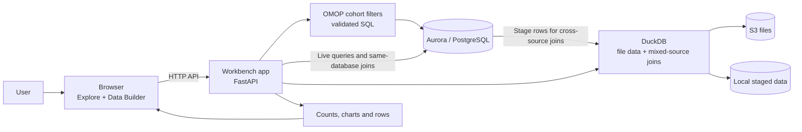

# Cohort Browser architecture

Live Aurora queries run in the database. DuckDB handles supported file data and mixed-source joins inside the app. OMOP cohorts are built from validated criteria and queried against Aurora.

[Detailed architecture and code references](architecture.md#detailed-service-and-omop-diagrams)
