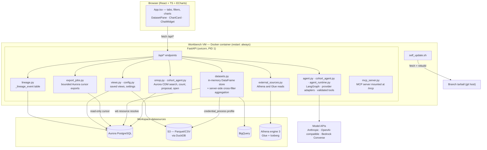
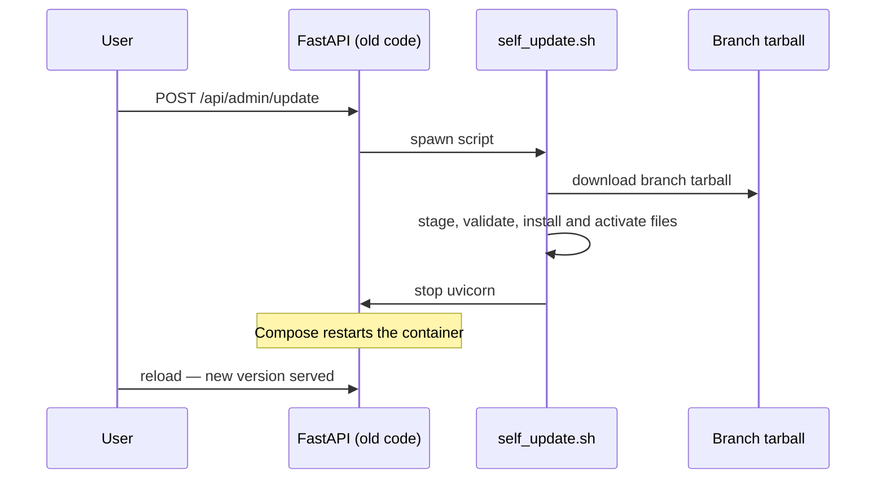
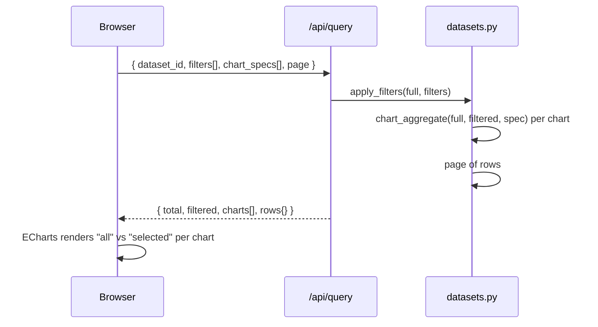

# Cohort Studio — architecture & flows

Current architecture and key flows for Cohort Studio. Update this document
when an architectural decision changes. Render diagrams with any Mermaid
viewer (GitHub renders them inline).

### Local changes awaiting release (2026-10-25)

The following decisions are implemented and locally tested, but are not in live
release `194f397b5`:

- S3/catalog data and cross-source joins use owned DuckDB files. Dashboard paging,
  filters and aggregates query the staged data instead of a 100,000-row sample.
  Connections use a 2 GB RAM limit and bounded disk spill. Estimated and actual
  byte guards warn at 10 GB and reject beyond 1 TB; streaming checks each batch
  before insertion. Failed registration deletes its owned data and spill files.
  These limits do not guarantee that the host has 1 TB free disk space.
- Aurora queries remain database-backed. Explicit SQL column ordering survives
  dashboard paging. BigQuery retains its sampled compatibility path; Athena
  full-source dashboard loading is not implemented.
- Join recipes are durable source references. Editing resolves those inputs and
  produces a new result tab; cancellation or failure preserves the original.
  Validation returns the actual compiler SQL, engine and separate bound values.
  DuckDB SQL uses logical staged aliases rather than physical file paths.
- Saved views are listed across permitted stores. Each entry retains its storage
  identity so opening, deletion and sharing use the correct store automatically.
- `knowledge.py` owns validated HTTP requests and prompt context formatting;
  `knowledge_store.py` owns SQLite/FTS persistence and retrieval. The knowledge
  base remains app-shared; relevant passages go to the selected inference provider.

The demo's cohort-to-genetics-to-workflow handoff is scoped in
[DEMO_OMOP_GENETICS.md](DEMO_OMOP_GENETICS.md). Exact cohort membership must persist
across the join. The Nextflow demo and S3 artifact round trip are verified.
Lineage records exact dataset IDs and event IDs for cohort, exported input,
parameter file and submitted run; output metadata records returned identifiers.
Automatic output-file discovery and notebook execution remain separate work.

## 1. Overall architecture



Credential model: Aurora creds come from `wb resource resolve` (ABAC,
per-resource); S3 access uses a `credential_process` AWS profile wired by
`wb workspace configure-aws`, exported into a DuckDB `SECRET ... PROVIDER
config` (DuckDB can't run `credential_process` itself).
Bedrock Converse uses the AWS SDK credential chain and a configured Region;
Workbench's resource-scoped S3 credentials are not known to grant model API
access. User-entered provider and Jev API keys use one server-configured
Secrets Manager secret encrypted by a customer KMS key when available. Otherwise,
keys use local AES-GCM encryption with a separate random key file. The secret
directory is mode 0700 and files are mode 0600, beside STUDIO_CONFIG unless
STUDIO_LOCAL_SECRET_DIR is set. Thread and file locks serialize access. Recovery
merges local changes and deletion markers into KMS storage before removing the
local copy. A durable mount must preserve both local files across container
replacement; this does not protect against compromise of the app account.
Deployment environment
keys take precedence; legacy local keys remain readable until an explicit,
read-back-verified migration removes them. Public settings expose key-presence
booleans and source labels only. Settings can replace or remove the Jev token;
saving does not test the provider connection. Join discovery reports whether
Jev was used or unavailable. See [AI access and key storage](AWS_AI_ACCESS.md).
AgentCore identity and network requirements remain open in the
[agent plan](AGENT_PLAN.md).

Athena resources use `STUDIO_ATHENA_RESOURCES` server configuration. Each
resource names an AWS Region, Glue catalog, enabled Athena engine 3 workgroup,
query-result S3 location and explicit database allowlist. The app uses a
server-side AWS profile or the app credential chain. The enforced workgroup
must set a positive per-query bytes-scanned cutoff. Athena handles Glue tables
and Iceberg; S3 Parquet files continue through DuckDB. See
[external source setup](EXTERNAL_SOURCES.md).

Views-only DuckDB catalogs (`catalog.py`) use the same path. The app
creates the secret from the profile of the folder that holds the
`.duckdb` file, then attaches the file `READ_ONLY` and queries its views.
DuckDB reads the Parquet that each view references with that secret.
Publishing builds the file locally (views only, verified to have no
tables) and uploads it with `aws s3 cp` to `<folder>/_catalog/`.

## 2. In-app update — what "Update" does

The browser calls the update endpoint. The script downloads the configured
branch, stages and validates the backend, installs dependencies, builds the
frontend, and copies the new files into the running container. It then stops
uvicorn; Compose restarts the container on the new files. This is an in-app
update: it does not recreate the Workbench app or VM. A VM start also runs the
script from `postStartCommand`.



The endpoint returns while the update runs. The UI polls `/api/version` for
the new commit SHA; update logs are written to `/tmp/self-update.log` in the
container. Changes to the devcontainer, Dockerfile, or Compose setup still
need an app/VM rebuild.

## Product direction: OMOP and multimodal data models

The primary user goal is to join OMOP clinical data with other modalities and
reuse the result for cohort analysis. Visual relationship editing, SQL editing,
and an isolated join assistant should create the same saved data model.
This is a target architecture; the SQL editor and isolated join agent are not
implemented by the current navigation change.

A model records versioned source references, entity grain, join keys and types,
relationship cardinality, filters, derived columns and lineage. Validate null
keys, duplicate keys, unmatched records and join fan-out before applying it.
Person counts must remain separate from event/sample/image rows. Cross-modal
identity mappings must be explicit, not guessed from similar column names.

Default “data cube” means a reusable logical query model. Optional cached extracts
are execution choices with visible scope, freshness and refresh controls. Same-
resource Aurora queries stay in Aurora; internal DuckDB handles supported mixed
sources. Current mixed-source joins operate on loaded frames and must not be
presented as full-source cubes.

The isolated assistant should inspect authorized metadata and aggregate join
profiles, propose the same typed model as the visual builder, and preview its
result before application. Browser isolation does not itself isolate agent
execution or credentials. An agent runtime needs a separate restricted tool
boundary. Generated SQL must use the same read-only execution and resource
boundaries as user-authored SQL.

## 3. OMOP and cohort assistant

OMOP is a capability of the selected Aurora datasource within Explore. It uses
the shared datasource selector, not a separate global workspace or database.
Collection data must be exported/accessed and loaded into Aurora before CDM
detection can find it; selecting a collection does not create clinical tables.

`omop.py` detects a CDM and vocabulary schema on the selected Aurora resource,
searches concepts, and compiles validated cohort specifications into
parameterized SQL. Cohorts retain a validated `omop_cohort` source recipe with
`membership_mode: live`; reopening reruns the criteria against current Aurora data.
This is not a frozen membership snapshot. Cohort counts, paging, joins and derived
columns query Aurora; only a bounded preview stays in memory. Internal compiler
queries carry a typed wrapper so OMOP CTE/EXISTS SQL can use resource guards
without relaxing validation for user SQL. Clinical table loading retains its
existing behavior. The S3
import CLI accepts a self-contained CSV/CSV.gz OMOP export (or ZIP), stages it
from a selected Workbench S3 resource, and uses PostgreSQL `COPY` into Aurora.
It does not convert raw claims, Parquet, or BigQuery tables into OMOP.

`agent_runtime.py` runs dataset and cohort chats as a LangGraph StateGraph with
model and tool execution nodes. Provider adapters normalize OpenAI-compatible,
Vertex AI, Anthropic, and Bedrock responses into LangChain messages. Each tool
call is checked against its JSON schema through Pydantic before its bound
function runs. Tool errors returned to the model are sanitized, and each chat
stops after eight model turns, ten minutes, 16 calls in one response, or 64
calls total. Tool results are capped at 64 KiB. Model SDK retries are disabled
and request timeouts are bounded. LangSmith tracing is disabled so prompts,
history, and tool data stay in the app's own telemetry path. Session storage is
managed separately from the graph. Dataset tools act on the selected in-memory
dataset; cohort tools are bound to the selected Aurora resource and return
concept search, aggregate counts, validated proposals, and read-only
workflow/app status. The cohort
assistant does not write database rows or mutate workflows/apps. The user
reviews and applies a proposal in the UI, then uses the existing Count/Open
actions. AgentCore is a separate, unprovisioned plan ([agent plan](AGENT_PLAN.md)).

### CMS SynPUF export and import path

The canonical source is public BigQuery `bigquery-public-data.cms_synthetic_patient_data_omop`.
Select 100,000 distinct person IDs with the documented deterministic order, then
export their linked clinical rows, selected-event costs, and local CSV.GZ files
with a checksum manifest. Keep the full concept vocabulary, relationship, and
drug-strength tables; restrict concept ancestry to descendants observed in the
selected records. Stage the bundle through a resource-scoped Workbench S3
resource, then load it into a new `cms_synpuf_100k` schema on the existing Aurora
resource in one transaction. Do not deploy a separate PostgreSQL service.

The source has no `cdm_source` or `visit_occurrence`, so its CDM version remains
unknown and no visit rows are invented. Preserve `procedure_dat` in the export
and map it to `procedure_date` during load. Export and loader code are present;
the export and Aurora load are not yet verified complete.

### Storage boundary

Production storage is the existing Workbench Aurora resource. DuckDB handles
loaded-frame analytics and cross-source joins inside Studio. Studio does not
provision or run a separate PostgreSQL database. Local tests use a disposable
PostgreSQL process to check the Aurora PostgreSQL SQL/driver contract; this is
a test fixture, not an application dependency or deployment service. Passing
those tests does not establish live Aurora connectivity or permissions.

## 4. One state round-trip (filter / chart change)

The frontend is thin: it sends the current filter set and the charts it
is showing; the server returns counts, per-chart aggregates (full and
filtered cohort), and one page of rows — everything for a render in a
single call. All statistics stay server-side.

Loaded-frame aggregation has two interchangeable backends behind the same response
shape: pandas (`datasets.py`) for small frames, and DuckDB SQL over the
in-memory frame (`agg_duck.py`) once row count crosses
`STUDIO_DUCKDB_AGG_ROWS` (default 50k). The DuckDB path pushes filtering,
group/count, binning and paging into a vectorised columnar engine; parity
tests pin its output to the pandas path, and any DuckDB error falls back
to pandas rather than failing the query.



Aurora table opens, SQL sources, and same-database joins use a third backend,
`live_query.py`. The server retains the source SQL and physical column map.
Counts, entity counts, filters, chart aggregates and pages query the full source
under a statement timeout. The in-memory frame is a 100,000-row preview only and
does not mark a live dataset as sampled. Live query errors do not fall back to
preview rows. Scatter and heatmap output is bounded and marked when sampled.
Full-source profiles supply filter choices and numeric ranges. Cross-resource
joins remain loaded-frame DuckDB operations and require explicit consent.

Compare uses `live_compare.py` to query both full-source groups in Aurora.
Derived columns use `live_derive.py` to compile the validated operation into a
database expression; the result stays database-scoped. A bounded recursive
`derived` source recipe records the base and validated operation, so saved
views can rebuild the derived column without storing SQL. Dataset chat remains
loaded-frame-only and is hidden for database-scoped sources.

The optional entity column counts distinct non-null values alongside row counts.
It is selected explicitly; the app never assumes that a joined row is a person.

The database-backed **Export TSV** action uses `export_jobs.py`. It streams an
Aurora cursor into a temporary TSV and makes the file downloadable only after
an atomic completion step. The UI polls row progress, supports cancellation,
and provides a download link for completed jobs. The service allows 2 workers,
8 retained jobs, 2 GiB per job and 4 GiB total. It removes finished jobs after
1 hour, stops work after 30 minutes, and applies a 5-minute database statement
timeout. These limits apply to this asynchronous database export path. The
older synchronous export, materialization and S3 workflow export still cap at
100,000 rows. No database service or schema is added for exports; temporary
files use the app container's local disk.

### Query cache and large results

Explore caches successful Aurora query responses in process memory for 30 seconds
by default. The key includes resource, compiled source, output column order,
filters, charts, entity selection and page. The LRU budget is 64 entries and
32 MiB of serialized result data, with a 4 MiB per-entry limit. No cache files
or extra storage service are created. Actual Python memory includes object
overhead. `STUDIO_QUERY_CACHE_TTL` sets 0–300 seconds; zero disables caching.

Responses report cache status and fetch time. Refresh data invalidates the
resource cache, runs a fresh query, and refreshes category/range profiles.
Generation checks prevent an older in-flight request from repopulating an
invalidated cache. Successful materialization also invalidates the target
resource. Background exports always query Aurora directly and bypass this
cache. OMOP cohort count retains its
existing behavior and is not cached by this layer.

The UI gives a brief performance warning for large sources. It states whether
counts cover the database or only loaded rows. Database query pages have no row
limit; 100,000 rows is only the in-memory preview size. Export, workflow, and
materialization limits remain separate from dashboard exploration.

## 5. Saved views / state persistence

A saved view captures every open tab (datasource-backed ones — uploads
can't be reloaded) with its filters and charts, into Aurora (a
`_studio_views` row) or S3 (a JSON object), so state survives the app
closing. The in-memory DataFrame store is reconstructed by re-opening
each tab's datasource on load.

`source_models.py` validates recursive table/join/derived recipes. Saved state
contains resource IDs, schema/table names, join conditions, aliases, selected
columns, derived operations and column settings. It never accepts client SQL or
session dataset IDs as a durable source. Reopening compiles the recipe again
and closes temporary input datasets. Trees are bounded to 16 sources and four
levels. Uploaded frames do not have a reloadable recipe. The selected entity
column is saved with the view.

Join execution returns `DATASET_EXPIRED` for missing input handles. The browser
reopens inputs from durable source recipes and retries once with new IDs. It
keeps tab filters and charts, updates handles only after success, and closes new
handles if recovery fails. Uploaded data needs another upload. Other failures,
including query timeouts, do not trigger this retry.
Each join opens a new result tab, even when an earlier result has the same source
label. The label is not an identity for the join conditions or result.

Column settings keep physical decoding separate from logical number/text
behavior. Numeric conversions validate the full Aurora column before committing
the change. Labels and filter kinds are display metadata. The source recipe
stores settings so reopened views use the same interpretation. Settings are
reapplied to the original source, so a second type change has the same result
before and after reopening. Aurora logical numbers use exact numeric storage
to preserve distinct large IDs; chart coordinates still use floating-point values.

## 6. Isolated browser deployment

`src/virtual-browser-cohort-studio` runs the same Studio image behind a
server-side Chromium session streamed by Selkies. Only the browser stream is
published to the Workbench proxy; Studio runs on a private Compose network.
The kiosk policy allows Chromium to reach only `application-server:8080` and
blocks downloads, clipboard copy-out, and other navigation. Backend data and
model calls remain in the app container. This sidecar changes the access path,
not the data or cohort engine.

## 7. Decision record

| Date | Decision | Reason |
|---|---|---|
| 2026-10-23 | Select sources inside the join builder; use schema constraints before optional Jev classification/ranking. | Remove the need to open tabs first. Keep database evidence separate from model confidence and require users to apply suggested keys. |
| 2026-10-23 | Validate the running app in a local container stack with PostgreSQL and synthetic fixtures. | Test real browser/API/driver behavior before a dev Aurora smoke test; local PostgreSQL does not verify Workbench access or browser isolation. |
| 2026-10-21 | Use the in-app Update action for code releases. | Fetch and build inside the existing container; no Workbench app recreation. Infrastructure changes remain separate. |
| 2026-10-21 | Prefer browser and HTTP/MCP outcome tests; retain real database and updater-process checks. | Verify user flows and storage behavior without duplicating implementation in unit tests. |
| 2026-10-21 | Keep explanation in this document; omit ordinary code comments. | Maintain one place for design decisions. Keep required directives, legal text and runtime tool descriptions. |
| 2026-10-21 | Scope Jev as an optional routing/ranking experiment. | Existing UI routes explicitly; no measured benefit yet. SQL remains authoritative for membership and counts. See [Jev scope](JEV_SCOPE.md). |
| 2026-10-21 | Use Aurora storage and internal DuckDB; no standalone PostgreSQL service. | User requirement. Disposable PostgreSQL is only a local Aurora-compatibility test fixture. |
| 2026-10-21 | Query same-resource Aurora joins as live sources. | Filters and counts must include matches beyond the preview cap. Validate against real PostgreSQL with more than 100,000 joined rows. |
| 2026-10-24 | Open Aurora tables as live sources and keep preview caps out of dashboard sampled status. | Dashboard pages and aggregates query the full database source; the in-memory frame stays bounded. Cross-source loaded-row consent remains explicit. |
| 2026-10-21 | Add a short-lived bounded in-memory Explore cache with explicit refresh. | Reduce repeated Aurora queries while making freshness visible; never cache exports or silently sample results. |
| 2026-10-21 | Persist bounded structured source recipes, not SQL. | Reopen joined views after in-app updates without trusting client SQL. |
| 2026-10-21 | Show rows and explicit distinct-entity counts separately. | One-to-many joins must not inflate person counts. |
| 2026-10-21 | Validate column conversions before changing stored state. | Text storage must remain decodable; invalid values outside the preview must fail the conversion. |
| 2026-10-21 | Support full-source compare and derived columns on live Aurora data; keep chat loaded-frame-only. | Avoid making results depend on a capped preview when the source can be queried directly. Save derived operations as validated recursive source recipes. |
| 2026-10-21 | Stream full-source TSV exports into bounded temporary jobs. | Avoid synchronous whole-result loads; expose progress and cancellation while limiting local disk and concurrent work. |
| 2026-10-21 | Place OMOP tools under the selected Aurora datasource in Explore. | One datasource selection controls tables and cohort building; collection-to-Aurora loading remains a separate data operation. |
| 2026-10-21 | Export the authorized SynPUF sample from canonical public BigQuery, stage it in resource-scoped S3, and load a new schema in existing Aurora. | Keep the sample deterministic and linked, preserve vocabulary while bounding ancestry, retain unknown source CDM version, and avoid a standalone PostgreSQL deployment. |

Record a changed decision here with its date, reason and verification needed.

### Aurora schema browser and join workspace (2026-10-22)

The normal Aurora browser lists accessible non-system schemas. Public names remain unchanged; other tables display as `schema.table`. API metadata carries schema and table separately, and opening uses a structured source reference so joins and saved views keep the same schema. The join editor hides the active dataset toolbar and charts until closed or a result is opened. Unrelated first columns are not default join keys.

### Vertex AI and concise UI (2026-10-22)

Vertex AI is a separate `vertexai` provider from the Gemini Developer API. Set
`GOOGLE_CLOUD_PROJECT` and `GOOGLE_CLOUD_LOCATION` (aliases `VERTEXAI_PROJECT` and
`VERTEXAI_LOCATION`) in the app environment. Select the model in Settings. The
server must have ADC through an appropriate service identity or supported
credential configuration; a local gcloud CLI login is not proof of app ADC.
The project needs Vertex AI API access, appropriate prediction permissions, and
applicable billing/quota. Credentials refresh before inference; no Vertex API
key or bearer token is persisted. Configured project/location does not prove
credentials or model access. No live Vertex inference has been verified.

UI structure and primary labels carry navigation. Remove redundant taglines and
helper text; retain data scope, errors and warnings that affect decisions.
Shared provider validation serves UI and agent paths to keep their behavior
consistent. Root agent instructions record this UX/DX/AX decision rule.

### Openweight model service (2026-10-24)

`openweight` uses the existing OpenAI-compatible adapter for chat, tools, and
filter suggestions. The service endpoint and model are administrator settings:
set `STUDIO_OPENWEIGHT_BASE_URL` and `STUDIO_OPENWEIGHT_MODEL` in the app
environment. The endpoint may use HTTP for private inference, but it cannot
contain URL credentials, a query, or a fragment. Settings shows only its
hostname and does not accept a browser-provided endpoint. The API key is
optional; set `STUDIO_OPENWEIGHT_API_KEY` or save it through the encrypted
model-key store. It has no local settings-file fallback. The model service is
separate from the isolated agent runtime. This provider does not download a
model, allocate a GPU, or provision a model server. Local compatibility tests
use a fake OpenAI-compatible endpoint; they do not verify a deployed model.

#### Deferred reference: Qwen/Qwen3.8-27B serving profile

The selected checkpoint is Apache-2.0 BF16; Hugging Face lists 55.6 GB of
files. For a 32K context test with one sequence, the proposed `openweight`
settings are:

```text
STUDIO_OPENWEIGHT_BASE_URL=http://<private-model-host>:8000/v1
STUDIO_OPENWEIGHT_MODEL=Qwen/Qwen3.8-27B
# STUDIO_OPENWEIGHT_API_KEY is optional; use only when the private server requires it.
```

The profile command below uses the official vLLM 0.17.0+ recipe's Qwen tool
parsers and vLLM's matching server options. It caps context at 32,768 tokens
and one running sequence. To cap at 16,384, change `--max-model-len` to
`16384`. Keep the listener on a private network and allow only the Studio app
to reach port 8000.

```bash
vllm serve Qwen/Qwen3.8-27B \
  --tensor-parallel-size 1 \
  --max-model-len 32768 \
  --max-num-seqs 1 \
  --reasoning-parser qwen3 \
  --enable-auto-tool-choice \
  --tool-call-parser qwen3_coder \
  --default-chat-template-kwargs '{"enable_thinking":false}' \
  --host 0.0.0.0 \
  --port 8000
```

The model card says thinking is enabled by default. The server template turns
it off so private reasoning does not enter assistant messages or Aurora
conversation history. The app stores only final message content. This profile
is not hardware-validated. Approximate GPU memory starts at 51.8 GiB for
55.6 GB of BF16 checkpoint files. A rough full-attention KV estimate is about
1 GiB at 16K and 2 GiB at 32K, using the model card's 16 full-attention
layers, four KV heads, 256 dimensions, and BF16 K/V. This excludes recurrent
linear-attention state, runtime buffers, activations and vision processing;
measure peak usage before selecting hardware. Do not treat this as a fit
guarantee.

AWS publishes `p5.4xlarge` with one H100 and 80 GB HBM3, which is a plausible
single-GPU candidate for this BF16 profile. A single G6e L40S has 48 GB and
cannot hold the BF16 checkpoint as listed. Region availability, quota, price,
and account GPU inventory remain unchecked. No AWS resource was created. The
vLLM recipe provides a pip/CLI launch, not an official verified Compose image
profile, so the app Compose files do not start a model server. No weights were
downloaded.

References: [Qwen model card](https://huggingface.co/Qwen/Qwen3.8-27B),
[official vLLM Qwen recipe](https://recipes.vllm.ai/Qwen/Qwen3.8-27B),
[vLLM 0.17.0 serve options](https://docs.vllm.ai/en/v0.17.0/cli/serve/),
[AWS accelerated instance specs](https://aws.amazon.com/ec2/instance-types/accelerated-computing/).

### Synthetic genetics demo (2026-10-22)

Genetics demo data lives in a separate Aurora schema. `samples.person_id` links
to the existing synthetic OMOP people; sample_id and variant_id link genotype
facts to sample and variant annotations. IDs, gene names, coordinates and
consequences are fabricated and marked synthetic. A seeded planted pattern
provides a known outcome for join/filter checks, not scientific association
evidence. CSV exports read committed tables and include provenance.

### Source selection and key recommendations (2026-10-23)

The join workspace can start empty and add tables by resource/schema/name.
Each step shows keys and join type; additional conditions, aliases and output
columns live under Advanced. Recommendations are applied explicitly. For later
steps the UI checks the base and prior sources, maps keys to their output aliases,
and excludes columns removed by earlier steps.

`POST /api/joins/recommend` takes two validated Aurora source references.
`join_discovery.py` reads schema constraints and types in a read-only transaction
with a three-second statement timeout. A projected `LIMIT 1` probe returns only
non-null flags, not field values. It does not measure overlap or cardinality.
Declared foreign keys rank first, retaining composite keys. Compatible names
are considered only for identifier-shaped or declared key columns.

Optional Jev classification uses the TypeSafe System One endpoint, with
`TYPESAFE_API_KEY` and an explicit `STUDIO_JEV_MODEL` (or `TYPESAFE_MODEL`). It
classifies qualified identifiers and ranks bounded candidate pairs. Invalid
answers, timeouts and abstention leave deterministic recommendations intact.
No row values are sent to the model. Model probability is not a match rate.
The normal chat/provider loop is unchanged. Schema metadata and recommendations
use bounded process caches with a default 30-second TTL and explicit refresh.

The local Compose stack runs PostgreSQL, an idempotent synthetic fixture seed,
and the built Studio app. A local-only launcher registers that database without
Workbench credentials or changes to production `db.py`. See
[local validation](LOCAL_VALIDATION.md) for commands and verification limits.

### Automatic OMOP cohort summaries (2026-10-23)

Performance policy: keep live query recipes or ordinary views as the default.
Ordinary views do not cache results. Measure Aurora plans and timings before
adding materialized views for repeated expensive summaries. Any materialized
result needs an explicit refresh policy and visible freshness; do not create
one per transient filter combination. This release adds no materialized views
or OMOP summary cache.

Tables and OMOP are explicit views of the selected Aurora datasource. OMOP
criteria and demographics trigger a debounced aggregate summary request, without
opening patient rows or requiring an AI provider. The existing strict cohort
compiler remains authoritative for cohort membership and attrition. Gender and
age charts count cohort people; selected-domain charts join those people to
clinical tables and vocabulary through fixed OMOP columns and count distinct
people per concept. Domains are aggregated separately to prevent event fanout.
Domain charts describe all recorded domain events for the selected people;
criterion event windows determine membership, not the domain-history window.

The summary runs in a read-only repeatable-read transaction with a total query
budget. Browser request cancellation and stale-response guards prevent an old
filter selection from replacing a newer chart. This browser cancellation alone
does not guarantee immediate cancellation of an already-running database query.

### Cohort result presentation (2026-10-23)

Cohort criteria and demographics stay above the result area. The result area
spans the workspace and switches between charts and aggregate tables. Opening
cohort people is separate from opening a selected clinical table; the latter
can use the current cohort or the whole table. Dataset count controls and
export actions use one wrapping, aligned toolbar.

The proposed workflow demo uses the existing Workbench workflow/S3 handoff.
It is scoped, not implemented or submitted; see [demo scope](DEMO_WORKFLOW_SCOPE.md).

### Custom Aurora SQL sources (2026-10-23)

The join builder accepts a named SQL source through Preview then Add. The
backend validates a single read-only PostgreSQL query with a SQL parser,
schema-qualified table names, and an allowlist of built-in functions. DML,
DDL, locking, system schemas, external databases, custom types/functions and
schema-qualified operators are rejected. Each execution uses a read-only
transaction, a controlled search path and a statement timeout. Preview is
bounded; same-Aurora joins and live analytics query the full source.

The saved source recipe stores resource, normalized SQL, name and column
settings. Reopen validates the query again using the same resource resolver
as normal Aurora sources. A preview is not an authorization token. Editing
a query invalidates its preview. This is an Aurora SQL editor, not an Athena
connector. Existing resource permissions remain authoritative.

### Scoped knowledge layer (2026-10-23; not implemented)

Veibot knowledge ingestion will reuse registered sources, with bounded ingestion
workers and versioned chunks in Aurora. pgvector and a local EmbeddingGemma 2
encoder are candidates pending extension/grant and instance benchmarks. Structured
counts and joins remain SQL operations; retrieval provides cited evidence. A
single typed capability registry should serve both the agent and local MCP.
See [knowledge scope](KNOWLEDGE_BASE_SCOPE.md) for boundaries and acceptance checks.

### Snapshot and connector execution decisions (2026-10-23)

PostgreSQL/RDS shares the Aurora SQL execution path through a resource router;
existing Workbench resolution remains intact. Server metadata may register
PostgreSQL Secrets Manager references, S3 locations and Athena workgroups.
PostgreSQL connections require verified TLS and default to read-only. Athena
reads Glue catalog tables, including Iceberg, using enforced engine-3 workgroups
with a scan cap. Cross-source joins require explicit consent to use loaded rows.
They do not claim full federated execution.

Eligible same-database saved joins use native PostgreSQL materialized views.
A registry stores generated physical names, original recipes and logical column
maps. Snapshot creation and saved-view state publication are transactional;
refresh is explicit, atomic and currently blocking. There is no implicit
CONCURRENTLY promise without a proven unique key/index. Lock acquisition is
bounded. Old unshared snapshots are cleaned during saved-view mutations, with
saved/open references and dependency closure protected. The current application
uses one process: dataset handles and jobs remain process-local. A process-local
lock closes open-versus-cleanup races; multi-worker deployment requires durable
leases and a shared job registry before it is supported.

Saving an open live join reuses its trusted server-held query rather than
reopening and profiling all its sources. Reopening an expired recipe can still
require database reads. Materialization avoids repeated joins but does not imply
an index or incremental refresh; measure plans and data volume before adding
indexes. No blanket indexes are created on arbitrary projections.

### Text knowledge base (2026-10-24)

Settings separates built-in assistant guidance from attached project documents.
`AGENT_GUIDE.md` and `agent_instructions.py` define the trusted role, available
capabilities, scientific checks, and tool limits. Attached documents enrich
retrieved context; they do not replace these instructions or grant tool access.
The UI retains the shared-corpus and selected-provider disclosure.

Initial retrieval uses SQLite FTS5 with BM25, not embeddings. The small app-owned
store is separate from Aurora clinical data and DuckDB analytics. It defaults to
knowledge.sqlite3 beside STUDIO_CONFIG; STUDIO_KNOWLEDGE_PATH selects a persistent
volume location. The instance shares one corpus; there is no per-user corpus ACL.
Limits are 100 documents and 200,000 characters each. Documents are deduplicated
by text SHA-256 and split into overlapping bounded passages. Search accepts only
quoted word tokens, returns at most ten passages, and binds all SQL values.

Settings uploads UTF-8 text or accepts pasted text. No URL fetch, S3 importer,
PDF parser, model download, or vector extension is included. Existing assistants
retrieve four passages per question, send them to the configured model provider,
and request KB document/passage citations. Retrieved text is untrusted evidence,
not tool authorization or live analytical results. MCP provides read-only search.
Document creation/removal stays in the user-facing API. Local persistence does
not imply backup or survival of container replacement; deploy with a persistent
path before relying on those guarantees.

### Private conversations in the existing backend (2026-10-24)

The Aurora resource for agent state is explicitly selected with
STUDIO_AGENT_RESOURCE_ID. Migration creates `_studio_agent` and revokes PUBLIC
schema/table/sequence grants. Application source validation and listing exclude
internal data. Database administrators still retain their database privileges;
UI hiding is not a substitute for separate database roles.

Prompts are versioned by digest. Conversations retain user and final assistant
messages, with token-like secrets redacted. Raw tool rows, tool arguments, and
model reasoning are not stored in telemetry. Events store status, timing and
usage. Conversations survive app process restarts; history requires the same
browser-owner cookie and a matching source scope. Clearing cookies or replacing
an unpersisted browser profile loses that owner binding; cross-device account
recovery is not implemented. Uploaded ephemeral datasets require reopening the
original context. Session concurrency uses a renewable database lease. Interrupted
runs do not replay tools automatically. Runtime context uses the last 30 messages,
while the history API pages the full saved conversation. Telemetry cleanup is an
explicit administrator command; conversations are not removed by it.

The managed Workbench Aurora role rejects GRANT/REVOKE. On 2026-10-24 the user
chose shared, non-private storage in that database under `_studio_agent`.
The explicit migration option `--managed-access` leaves existing managed
permissions unchanged. Database readers may access conversations and telemetry;
prefixes and table-picker/SQL-source exclusions provide application organization,
not database privacy. API keys remain outside these tables in encrypted storage.
Without this option migration still requests private permissions, which require
an administrator on this managed resource.

The application remains in the monorepo and existing container topology.
LangGraph runs in the Studio backend and calls model APIs. The experimental
agent sidecar and gateway were removed at the user's request. No separate model
container or GPU deployment is part of this update. LangSmith tracing is disabled;
Aurora stores conversations and telemetry with the configured database permissions.

Hosting decision (2026-10-24): use one application container for Studio and its
agent runtime, with general inference-provider APIs and available models.
Do not download Qwen or provision a GPU under the current scope. Bedrock model
inference and AgentCore runtime hosting remain future options, pending verified
access and integration tests. Existing browser-isolation infrastructure remains
unchanged; it is not a separate agent runtime.

### Cohort genetics Nextflow demo (2026-10-25)

The demo is a registered Workbench Nextflow workflow, not another app container.
The launcher exports the selected dataset filters to S3, projects six validated
columns, and rejects capped inputs. An export fingerprint prevents reuse after
source, path or filter changes. Only the demo uses the dedicated params-file
adapter; existing batch workflows keep their CLI contract.

Workflow tasks use a digest-pinned existing ECR image and an offline Pydantic
archive built with uv. The task validates one variant and unique people/samples,
then writes carrier counts by gender and birth decade, a synthetic dictionary,
and a hash/count manifest. Dictionary annotations do not determine carrier status.
Outputs publish through the HealthOmics mount `/mnt/workflow/pubdir`. Output
bucket/key are plain metadata parameters, because passing a future S3 URI caused
input validation to fail. Workbench appends the job name to the selected output
path. HealthOmics adds its engine run ID and `pubdir`; the task reads
`AWS_WORKFLOW_RUN_ID` to record the final artifact URIs. The manifest does not
claim a Workbench run UUID or source tables unless
provided. No IAM changes or new compute service are required.

### Filter history and appearance (2026-10-25)

Database filter questions retain the last 25 question/result entries on the dataset.
Saved views serialize these entries through bounded Pydantic fields; reopening a
view restores them. Unsaved browser state is not a durable conversation store.
Dataset tool chat continues to use the existing server-owned session history.
Appearance is a browser preference (light, dark or system), stored locally and
applied through CSS variables; chart labels and palettes react to theme changes.
