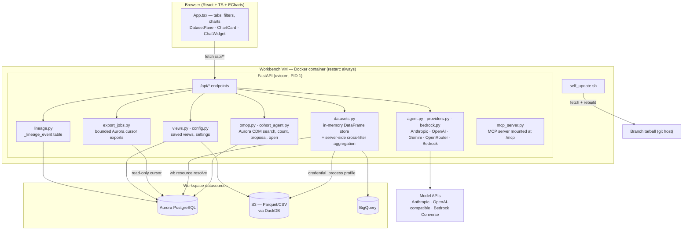
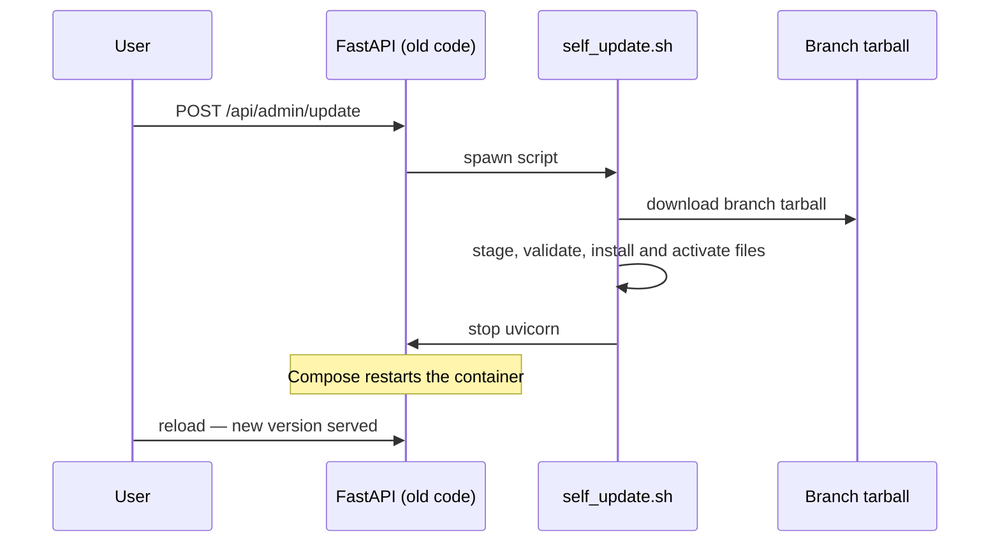
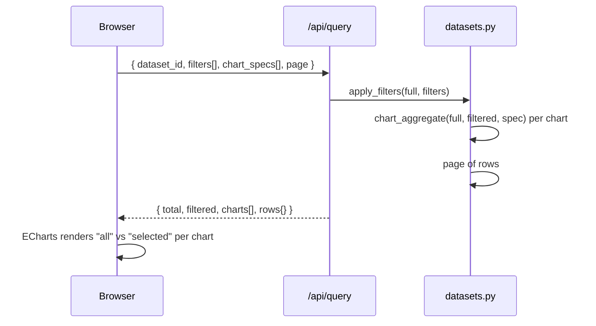

# Cohort Studio — architecture & flows

Current architecture and key flows for Cohort Studio. Update this document
when an architectural decision changes. Render diagrams with any Mermaid
viewer (GitHub renders them inline).

## 1. Overall architecture

Credential model: Aurora creds come from `wb resource resolve` (ABAC,
per-resource); S3 access uses a `credential_process` AWS profile wired by
`wb workspace configure-aws`, exported into a DuckDB `SECRET ... PROVIDER
config` (DuckDB can't run `credential_process` itself).
Bedrock Converse uses the AWS SDK credential chain and a configured Region;
Workbench's resource-scoped S3 credentials are not known to grant model API
access. AgentCore identity and network requirements remain open in the
[agent plan](AGENT_PLAN.md).

Views-only DuckDB catalogs (`catalog.py`) use the same path. The app
creates the secret from the profile of the folder that holds the
`.duckdb` file, then attaches the file `READ_ONLY` and queries its views.
DuckDB reads the Parquet that each view references with that secret.
Publishing builds the file locally (views only, verified to have no
tables) and uploads it with `aws s3 cp` to `<folder>/_catalog/`.

## 2. In-app update — what "Update" does

The browser calls the update endpoint. The script downloads the configured
branch, stages and validates the backend, installs dependencies, builds the
frontend, and copies the new files into the running container. It then stops
uvicorn; Compose restarts the container on the new files. This is an in-app
update: it does not recreate the Workbench app or VM. A VM start also runs the
script from `postStartCommand`.

The endpoint returns while the update runs. The UI polls `/api/version` for
the new commit SHA; update logs are written to `/tmp/self-update.log` in the
container. Changes to the devcontainer, Dockerfile, or Compose setup still
need an app/VM rebuild.

## Product direction: OMOP and multimodal data models

The primary user goal is to join OMOP clinical data with other modalities and
reuse the result for cohort analysis. Visual relationship editing, SQL editing,
and an isolated join assistant should create the same saved data model.
This is a target architecture; the SQL editor and isolated join agent are not
implemented by the current navigation change.

A model records versioned source references, entity grain, join keys and types,
relationship cardinality, filters, derived columns and lineage. Validate null
keys, duplicate keys, unmatched records and join fan-out before applying it.
Person counts must remain separate from event/sample/image rows. Cross-modal
identity mappings must be explicit, not guessed from similar column names.

Default “data cube” means a reusable logical query model. Optional cached extracts
are execution choices with visible scope, freshness and refresh controls. Same-
resource Aurora queries stay in Aurora; internal DuckDB handles supported mixed
sources. Current mixed-source joins operate on loaded frames and must not be
presented as full-source cubes.

The isolated assistant should inspect authorized metadata and aggregate join
profiles, propose the same typed model as the visual builder, and preview its
result before application. Browser isolation does not itself isolate agent
execution or credentials. An agent runtime needs a separate restricted tool
boundary. Generated SQL must use the same read-only execution and resource
boundaries as user-authored SQL.

## 3. OMOP and cohort assistant

OMOP is a capability of the selected Aurora datasource within Explore. It uses
the shared datasource selector, not a separate global workspace or database.
Collection data must be exported/accessed and loaded into Aurora before CDM
detection can find it; selecting a collection does not create clinical tables.

`omop.py` detects a CDM and vocabulary schema on the selected Aurora resource,
searches concepts, and compiles validated cohort specifications into
parameterized SQL. Counts and attrition stay in Aurora; opening a cohort or
clinical table loads rows into the existing in-memory dataset store. The S3
import CLI accepts a self-contained CSV/CSV.gz OMOP export (or ZIP), stages it
from a selected Workbench S3 resource, and uses PostgreSQL `COPY` into Aurora.
It does not convert raw claims, Parquet, or BigQuery tables into OMOP.

`cohort_agent.py` is a server-side specialist using the configured LLM provider.
Its tools are bound to the selected Aurora resource and return concept search,
aggregate counts, validated proposals, and read-only workflow/app status. It
does not write database rows or mutate workflows/apps. The user reviews and
applies a proposal in the UI, then uses the existing Count/Open actions. Direct
Bedrock Converse is implemented; AgentCore is a separate, unprovisioned plan
([agent plan](AGENT_PLAN.md)).

### CMS SynPUF export and import path

The canonical source is public BigQuery `bigquery-public-data.cms_synthetic_patient_data_omop`.
Select 100,000 distinct person IDs with the documented deterministic order, then
export their linked clinical rows, selected-event costs, and local CSV.GZ files
with a checksum manifest. Keep the full concept vocabulary, relationship, and
drug-strength tables; restrict concept ancestry to descendants observed in the
selected records. Stage the bundle through a resource-scoped Workbench S3
resource, then load it into a new `cms_synpuf_100k` schema on the existing Aurora
resource in one transaction. Do not deploy a separate PostgreSQL service.

The source has no `cdm_source` or `visit_occurrence`, so its CDM version remains
unknown and no visit rows are invented. Preserve `procedure_dat` in the export
and map it to `procedure_date` during load. Export and loader code are present;
the export and Aurora load are not yet verified complete.

### Storage boundary

Production storage is the existing Workbench Aurora resource. DuckDB handles
loaded-frame analytics and cross-source joins inside Studio. Studio does not
provision or run a separate PostgreSQL database. Local tests use a disposable
PostgreSQL process to check the Aurora PostgreSQL SQL/driver contract; this is
a test fixture, not an application dependency or deployment service. Passing
those tests does not establish live Aurora connectivity or permissions.

## 4. One state round-trip (filter / chart change)

The frontend is thin: it sends the current filter set and the charts it
is showing; the server returns counts, per-chart aggregates (full and
filtered cohort), and one page of rows — everything for a render in a
single call. All statistics stay server-side.

Loaded-frame aggregation has two interchangeable backends behind the same response
shape: pandas (`datasets.py`) for small frames, and DuckDB SQL over the
in-memory frame (`agg_duck.py`) once row count crosses
`STUDIO_DUCKDB_AGG_ROWS` (default 50k). The DuckDB path pushes filtering,
group/count, binning and paging into a vectorised columnar engine; parity
tests pin its output to the pandas path, and any DuckDB error falls back
to pandas rather than failing the query.

Aurora joins use a third backend, `live_query.py`. The server retains its compiled
SELECT and physical column map. Counts, entity counts, filters, chart aggregates
and pages query that source under a statement timeout. The loaded frame is a
preview only. Live query errors do not fall back to preview rows. Scatter and
heatmap output is bounded and marked when sampled. Full-source profiles supply
filter choices and numeric ranges. Cross-resource joins remain loaded-frame
DuckDB operations.

Compare uses `live_compare.py` to query both full-source groups in Aurora.
Derived columns use `live_derive.py` to compile the validated operation into a
database expression; the result stays database-scoped. A bounded recursive
`derived` source recipe records the base and validated operation, so saved
views can rebuild the derived column without storing SQL. Dataset chat remains
loaded-frame-only and is hidden for database-scoped sources.

The optional entity column counts distinct non-null values alongside row counts.
It is selected explicitly; the app never assumes that a joined row is a person.

The database-backed **Export TSV** action uses `export_jobs.py`. It streams an
Aurora cursor into a temporary TSV and makes the file downloadable only after
an atomic completion step. The UI polls row progress, supports cancellation,
and provides a download link for completed jobs. The service allows 2 workers,
8 retained jobs, 2 GiB per job and 4 GiB total. It removes finished jobs after
1 hour, stops work after 30 minutes, and applies a 5-minute database statement
timeout. These limits apply to this asynchronous database export path. The
older synchronous export, materialization and S3 workflow export still cap at
100,000 rows. No database service or schema is added for exports; temporary
files use the app container's local disk.

### Query cache and large results

Explore caches successful Aurora query responses in process memory for 30 seconds
by default. The key includes resource, compiled source, output column order,
filters, charts, entity selection and page. The LRU budget is 64 entries and
32 MiB of serialized result data, with a 4 MiB per-entry limit. No cache files
or extra storage service are created. Actual Python memory includes object
overhead. `STUDIO_QUERY_CACHE_TTL` sets 0–300 seconds; zero disables caching.

Responses report cache status and fetch time. Refresh data invalidates the
resource cache, runs a fresh query, and refreshes category/range profiles.
Generation checks prevent an older in-flight request from repopulating an
invalidated cache. Successful materialization also invalidates the target
resource. Background exports always query Aurora directly and bypass this
cache. OMOP cohort count retains its
existing behavior and is not cached by this layer.

The UI warns at 100,000 source rows and when loaded data is capped. It states
whether counts cover the database or only the loaded preview. No query is
silently switched to a sample because its source is large.

## 5. Saved views / state persistence

A saved view captures every open tab (datasource-backed ones — uploads
can't be reloaded) with its filters and charts, into Aurora (a
`_studio_views` row) or S3 (a JSON object), so state survives the app
closing. The in-memory DataFrame store is reconstructed by re-opening
each tab's datasource on load.

`source_models.py` validates recursive table/join/derived recipes. Saved state
contains resource IDs, schema/table names, join conditions, aliases, selected
columns, derived operations and column settings. It never accepts client SQL or
session dataset IDs as a durable source. Reopening compiles the recipe again
and closes temporary input datasets. Trees are bounded to 16 sources and four
levels. Uploaded frames do not have a reloadable recipe. The selected entity
column is saved with the view.

Column settings keep physical decoding separate from logical number/text
behavior. Numeric conversions validate the full Aurora column before committing
the change. Labels and filter kinds are display metadata. The source recipe
stores settings so reopened views use the same interpretation. Settings are
reapplied to the original source, so a second type change has the same result
before and after reopening. Aurora logical numbers use exact numeric storage
to preserve distinct large IDs; chart coordinates still use floating-point values.

## 6. Isolated browser deployment

`src/virtual-browser-cohort-studio` runs the same Studio image behind a
server-side Chromium session streamed by Selkies. Only the browser stream is
published to the Workbench proxy; Studio runs on a private Compose network.
The kiosk policy allows Chromium to reach only `application-server:8080` and
blocks downloads, clipboard copy-out, and other navigation. Backend data and
model calls remain in the app container. This sidecar changes the access path,
not the data or cohort engine.

## 7. Decision record

| Date | Decision | Reason |
|---|---|---|
| 2026-10-21 | Use the in-app Update action for code releases. | Fetch and build inside the existing container; no Workbench app recreation. Infrastructure changes remain separate. |
| 2026-10-21 | Prefer browser and HTTP/MCP outcome tests; retain real database and updater-process checks. | Verify user flows and storage behavior without duplicating implementation in unit tests. |
| 2026-10-21 | Keep explanation in this document; omit ordinary code comments. | Maintain one place for design decisions. Keep required directives, legal text and runtime tool descriptions. |
| 2026-10-21 | Scope Jev as an optional routing/ranking experiment. | Existing UI routes explicitly; no measured benefit yet. SQL remains authoritative for membership and counts. See [Jev scope](JEV_SCOPE.md). |
| 2026-10-21 | Use Aurora storage and internal DuckDB; no standalone PostgreSQL service. | User requirement. Disposable PostgreSQL is only a local Aurora-compatibility test fixture. |
| 2026-10-21 | Query same-resource Aurora joins as live sources. | Filters and counts must include matches beyond the preview cap. Validate against real PostgreSQL with more than 100,000 joined rows. |
| 2026-10-21 | Add a short-lived bounded in-memory Explore cache with explicit refresh. | Reduce repeated Aurora queries while making freshness visible; never cache exports or silently sample results. |
| 2026-10-21 | Persist bounded structured source recipes, not SQL. | Reopen joined views after in-app updates without trusting client SQL. |
| 2026-10-21 | Show rows and explicit distinct-entity counts separately. | One-to-many joins must not inflate person counts. |
| 2026-10-21 | Validate column conversions before changing stored state. | Text storage must remain decodable; invalid values outside the preview must fail the conversion. |
| 2026-10-21 | Support full-source compare and derived columns on live Aurora data; keep chat loaded-frame-only. | Avoid making results depend on a capped preview when the source can be queried directly. Save derived operations as validated recursive source recipes. |
| 2026-10-21 | Stream full-source TSV exports into bounded temporary jobs. | Avoid synchronous whole-result loads; expose progress and cancellation while limiting local disk and concurrent work. |
| 2026-10-21 | Place OMOP tools under the selected Aurora datasource in Explore. | One datasource selection controls tables and cohort building; collection-to-Aurora loading remains a separate data operation. |
| 2026-10-21 | Export the authorized SynPUF sample from canonical public BigQuery, stage it in resource-scoped S3, and load a new schema in existing Aurora. | Keep the sample deterministic and linked, preserve vocabulary while bounding ancestry, retain unknown source CDM version, and avoid a standalone PostgreSQL deployment. |

Record a changed decision here with its date, reason and verification needed.

### Aurora schema browser and join workspace (2026-10-22)

The normal Aurora browser lists accessible non-system schemas. Public names remain unchanged; other tables display as `schema.table`. API metadata carries schema and table separately, and opening uses a structured source reference so joins and saved views keep the same schema. The join editor hides the active dataset toolbar and charts until closed or a result is opened. Unrelated first columns are not default join keys.

### Vertex AI and concise UI (2026-10-22)

Vertex AI is a separate `vertexai` provider from the Gemini Developer API. Set
`GOOGLE_CLOUD_PROJECT` and `GOOGLE_CLOUD_LOCATION` (aliases `VERTEXAI_PROJECT` and
`VERTEXAI_LOCATION`) in the app environment. Select the model in Settings. The
server must have ADC through an appropriate service identity or supported
credential configuration; a local gcloud CLI login is not proof of app ADC.
The project needs Vertex AI API access, appropriate prediction permissions, and
applicable billing/quota. Credentials refresh before inference; no Vertex API
key or bearer token is persisted. Configured project/location does not prove
credentials or model access. No live Vertex inference has been verified.

UI structure and primary labels carry navigation. Remove redundant taglines and
helper text; retain data scope, errors and warnings that affect decisions.
Shared provider validation serves UI and agent paths to keep their behavior
consistent. Root agent instructions record this UX/DX/AX decision rule.
