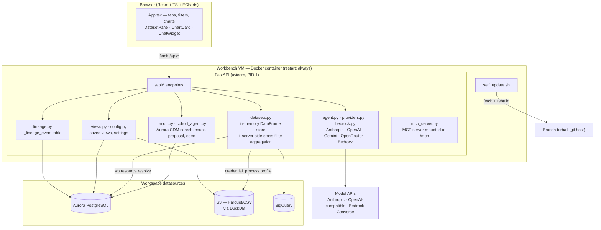
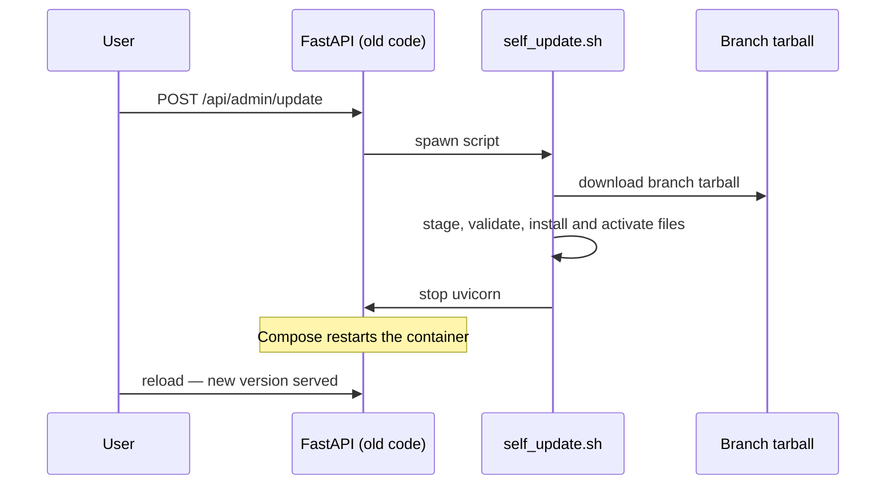
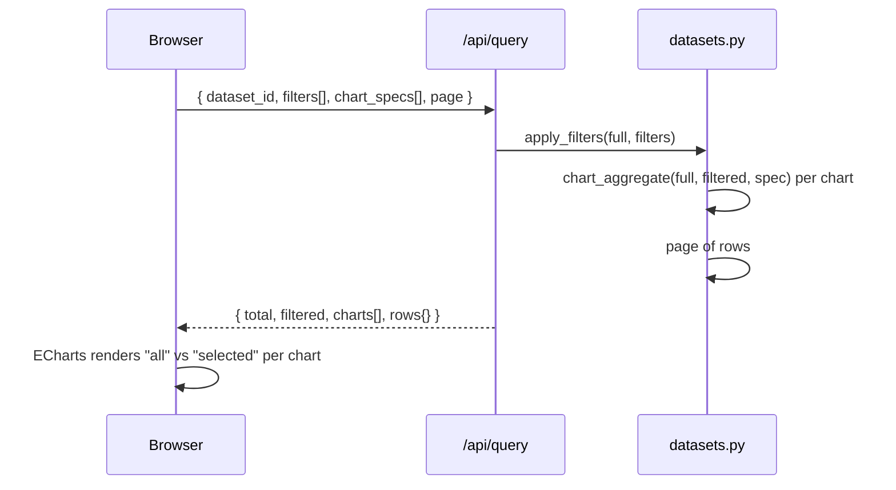

# Cohort Studio — architecture & flows

Current architecture and key flows for Cohort Studio. Update this document
when an architectural decision changes. Render diagrams with any Mermaid
viewer (GitHub renders them inline).

## 1. Overall architecture

Credential model: Aurora creds come from `wb resource resolve` (ABAC,
per-resource); S3 access uses a `credential_process` AWS profile wired by
`wb workspace configure-aws`, exported into a DuckDB `SECRET ... PROVIDER
config` (DuckDB can't run `credential_process` itself).
Bedrock Converse uses the AWS SDK credential chain and a configured Region;
Workbench's resource-scoped S3 credentials are not known to grant model API
access. AgentCore identity and network requirements remain open in the
[agent plan](AGENT_PLAN.md).

Views-only DuckDB catalogs (`catalog.py`) use the same path. The app
creates the secret from the profile of the folder that holds the
`.duckdb` file, then attaches the file `READ_ONLY` and queries its views.
DuckDB reads the Parquet that each view references with that secret.
Publishing builds the file locally (views only, verified to have no
tables) and uploads it with `aws s3 cp` to `<folder>/_catalog/`.

## 2. In-app update — what "Update" does

The browser calls the update endpoint. The script downloads the configured
branch, stages and validates the backend, installs dependencies, builds the
frontend, and copies the new files into the running container. It then stops
uvicorn; Compose restarts the container on the new files. This is an in-app
update: it does not recreate the Workbench app or VM. A VM start also runs the
script from `postStartCommand`.

The endpoint returns while the update runs. The UI polls `/api/version` for
the new commit SHA; update logs are written to `/tmp/self-update.log` in the
container. Changes to the devcontainer, Dockerfile, or Compose setup still
need an app/VM rebuild.

## 3. OMOP and cohort assistant

`omop.py` detects a CDM and vocabulary schema on the selected Aurora resource,
searches concepts, and compiles validated cohort specifications into
parameterized SQL. Counts and attrition stay in Aurora; opening a cohort or
clinical table loads rows into the existing in-memory dataset store. The S3
import CLI accepts a self-contained CSV/CSV.gz OMOP export (or ZIP), stages it
from a selected Workbench S3 resource, and uses PostgreSQL `COPY` into Aurora.
It does not convert raw claims, Parquet, or BigQuery tables into OMOP.

`cohort_agent.py` is a server-side specialist using the configured LLM provider.
Its tools are bound to the selected Aurora resource and return concept search,
aggregate counts, validated proposals, and read-only workflow/app status. It
does not write database rows or mutate workflows/apps. The user reviews and
applies a proposal in the UI, then uses the existing Count/Open actions. Direct
Bedrock Converse is implemented; AgentCore is a separate, unprovisioned plan
([agent plan](AGENT_PLAN.md)).

## 4. One state round-trip (filter / chart change)

The frontend is thin: it sends the current filter set and the charts it
is showing; the server returns counts, per-chart aggregates (full and
filtered cohort), and one page of rows — everything for a render in a
single call. All statistics stay server-side.

Aggregation has two interchangeable backends behind the same response
shape: pandas (`datasets.py`) for small frames, and DuckDB SQL over the
in-memory frame (`agg_duck.py`) once row count crosses
`STUDIO_DUCKDB_AGG_ROWS` (default 50k). The DuckDB path pushes filtering,
group/count, binning and paging into a vectorised columnar engine; parity
tests pin its output to the pandas path, and any DuckDB error falls back
to pandas rather than failing the query.

## 5. Saved views / state persistence

A saved view captures every open tab (datasource-backed ones — uploads
can't be reloaded) with its filters and charts, into Aurora (a
`_studio_views` row) or S3 (a JSON object), so state survives the app
closing. The in-memory DataFrame store is reconstructed by re-opening
each tab's datasource on load.

## 6. Isolated browser deployment

`src/virtual-browser-cohort-studio` runs the same Studio image behind a
server-side Chromium session streamed by Selkies. Only the browser stream is
published to the Workbench proxy; Studio runs on a private Compose network.
The kiosk policy allows Chromium to reach only `application-server:8080` and
blocks downloads, clipboard copy-out, and other navigation. Backend data and
model calls remain in the app container. This sidecar changes the access path,
not the data or cohort engine.

## 7. Decision record

| Date | Decision | Reason |
|---|---|---|
| 2026-10-21 | Use the in-app Update action for code releases. | Fetch and build inside the existing container; no Workbench app recreation. Infrastructure changes remain separate. |
| 2026-10-21 | Prefer browser and HTTP/MCP outcome tests; retain real database and updater-process checks. | Verify user flows and storage behavior without duplicating implementation in unit tests. |
| 2026-10-21 | Keep explanation in this document; omit ordinary code comments. | Maintain one place for design decisions. Keep required directives, legal text and runtime tool descriptions. |
| 2026-10-21 | Scope Jev as an optional routing/ranking experiment. | Existing UI routes explicitly; no measured benefit yet. SQL remains authoritative for membership and counts. See [Jev scope](JEV_SCOPE.md). |

Record a changed decision here with its date, reason and verification needed.
